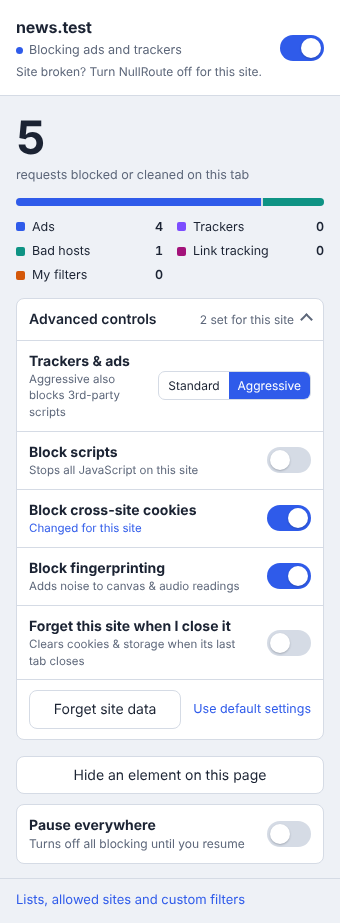
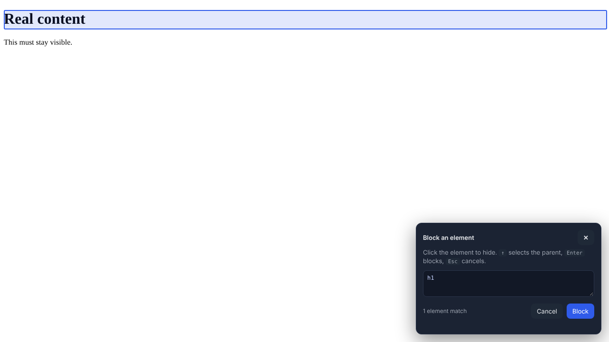
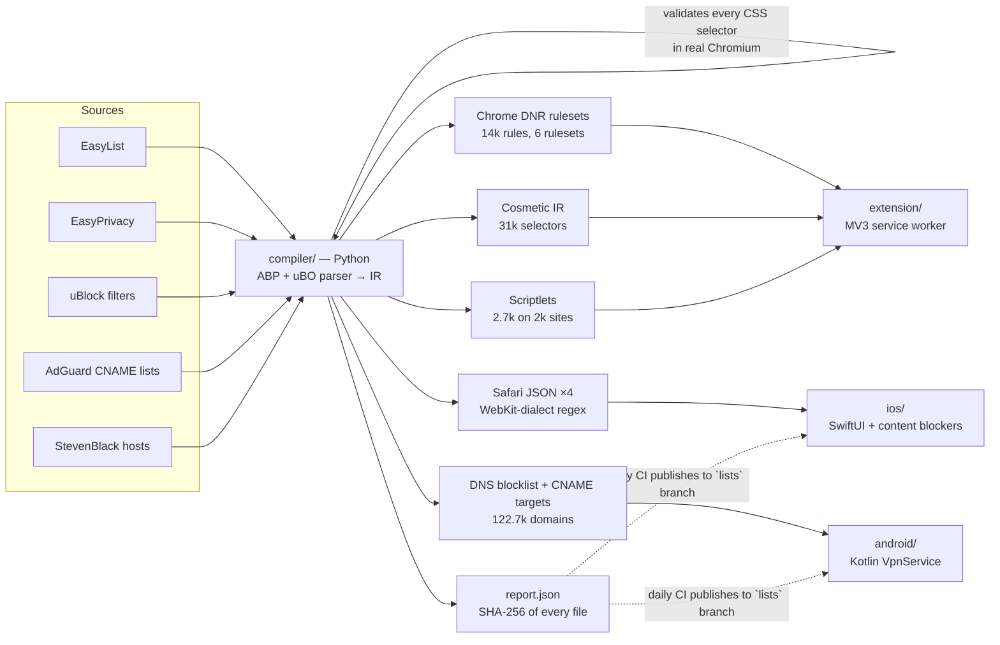

# NullRoute

**A cross-platform ad and tracker blocker: a Chrome extension, an Android app, and an iOS Safari blocker, all built from one filter-compilation pipeline.**

NullRoute compiles the community-maintained lists that power uBlock Origin and AdGuard (EasyList, EasyPrivacy, uBlock filters, AdGuard's CNAME-cloaking lists and StevenBlack hosts, about 526,000 lines in total). The compiler turns them into the native, OS-enforced rule format each platform expects:

| Platform | Mechanism | What it blocks |
|---|---|---|
| **Chrome** (MV3) | `declarativeNetRequest` static + dynamic rules, user-origin CSS, MAIN-world scriptlets, content settings | Network requests, CNAME-cloaked trackers, click-ID link tracking, anti-adblock scripts, on-page ad slots, plus Brave-style per-site controls (scripts, cross-site cookies, fingerprinting, site data) |
| **Android** | Local `VpnService` DNS sinkhole with **CNAME uncloaking** (only DNS enters the tunnel) | Ad and tracker domains in **every app**, including trackers disguised as first-party subdomains |
| **iOS / Safari** | Four Safari content-blocker extensions (WebKit rule lists) | Network requests and element hiding in Safari |

Blocking is always done by the browser or OS engine itself. NullRoute never proxies your traffic, never sees page contents, and keeps no browsing history on disk.

<p align="center"> </p>

---

## Architecture



### 1. Filter compiler (`compiler/`, Python, no runtime dependencies)

- **Parses Adblock Plus syntax**: `||domain^`, anchors, wildcards, `$third-party`, `$domain=`, `$denyallow`, `$important`, `$match-case`, `@@` exceptions, `$document`/`$elemhide`/`$generichide`, and `##` / `#@#` cosmetic filters.
- **Skips filters it can't reproduce faithfully** rather than approximating them. That covers regex filters, scriptlets, `$redirect`, `$csp` and procedural cosmetics. Each skip is counted in `report.json`, so a compiled rule never blocks more than its source filter intended.
- **Folds domain filters.** Every `||domain^` filter sharing the same options is merged into a single DNR rule with a `requestDomains` list. On the real lists this turns **about 480,000 network filters and domain entries into 14,025 Chrome rules**, so all six rulesets fit inside Chrome's guaranteed 30,000-rule static budget. The 300,034-domain CNAME-cloaking list alone folds into 161 rules.
- **Validates every CSS selector in Chromium** (`CSSStyleSheet.insertRule` via Playwright). One invalid selector in a grouped `a, b, c {}` rule silently disables the whole group, and on Safari it breaks the entire content blocker. The validator catches real cases, such as EasyList selectors with nested `:has()`.
- **Translates ABP patterns to WebKit's regex dialect**, which has no `|` alternation and no `{n,m}`. A validator mirrors WebKit's URL-filter parser rules.
- **Exports only exact domain filters to DNS.** It includes `||domain^` with no options plus hosts entries. A filter like `||cdn.site.com^$third-party` is excluded, because a resolver can't know whether a lookup is third-party, and sinkholing it would break the first-party site.
- **Has a canary test.** A list of essential domains (Google, WhatsApp, UPI/NPCI, banks, Play Store connectivity checks, and so on) must never be blocked. CI fails if a list update would break them.

- **Targets each list at the platforms that can use it.** For example, AdGuard's 300k cloaked-subdomain list goes only to Chrome. It's over Safari's cap, and Android uncloaks live instead.
- **Parses uBlock Origin scriptlets** (`##+js(...)`), with aliases, escaped arguments, per-site exceptions and `#@#+js()` disables. It also parses `$removeparam` filters for link-tracking stripping.

### 2. Chrome extension (`extension/`, Manifest V3)

- **Network blocking** uses Chrome's native `declarativeNetRequest` engine with three toggleable static rulesets (Ads, Trackers, Bad hosts).
- **Generic element hiding** is a static stylesheet registered as a content script at `document_start`, so ad slots never flash on screen. The 649 sites that have exceptions are excluded from it and get a filtered copy instead.
- **Site-specific element hiding** is injected per navigation with `scripting.insertCSS({origin: 'USER'})`, which pages can't detect or override.
- **Scriptlets in the page's MAIN world** at `document_start`, before any page script runs: `abort-on-property-read`/`-write`, `abort-current-script`, `set-constant`, `json-prune`, `addEventListener-defuser`, `no-setTimeout-if`/`no-setInterval-if` and `no-window-open-if`. Together these cover 2,726 rules on 2,073 sites. They follow uBlock Origin's semantics, and list arguments are only ever used as property paths and patterns, never evaluated as code.
- **Link-tracking removal.** 33 per-user click identifiers (`gclid`, `fbclid`, `msclkid`, `ttclid`, …) are stripped from navigations with DNR `queryTransform` redirects before the request leaves the browser. `utm_*` campaign tags are kept on purpose: they identify a campaign rather than a person, and removing them breaks landing pages.
- **CNAME-cloaked trackers.** Chrome gives extensions no DNS API, so it can't uncloak at runtime. Instead, AdGuard's pre-resolved list of cloaked first-party subdomains is compiled into rules.
- **Per-site advanced controls, modelled on Brave Shields.** Every site uses the global defaults (set on the options page) unless you change it from the popup; site changes win, cover subdomains, and are listed with a one-click reset:
  - *Trackers & ads: Aggressive* adds one dynamic DNR rule that blocks all third-party scripts and frames on that site (uBlock Origin's "medium mode"). Its priority sits above every list exception and below "shields down".
  - *Block scripts* uses `chrome.contentSettings.javascript`, which also stops inline scripts and event handlers. DNR alone can only block script files.
  - *Block cross-site cookies* is a DNR `modifyHeaders` rule that strips `Cookie` from third-party requests and `Set-Cookie` from their responses. First-party visits keep their cookies.
  - *Block fingerprinting* (on by default) adds per-page noise to canvas (`toDataURL`, `toBlob`, `getImageData`) and Web Audio readback, and reports a plausible CPU count. The noise is a pure function of a per-page seed and the content, so drawing the same canvas twice gives identical results; per-call random noise is easy to detect that way (IMC 2025). The wrappers are Proxies, so `toString()` still says `[native code]`.
  - *Forget site data* clears cookies, storage, IndexedDB, caches and service workers for the site, either on demand or automatically when its last tab closes. Tab-to-site mapping lives in `chrome.storage.session`, so it survives service-worker restarts.
  - *"Site broken? Turn NullRoute off for this site."* Shields down (priority 100 `allowAllRequests`) overrides every other control, including script blocking and fingerprint protection.
- **Popup:** a per-site on/off switch, a live per-category breakdown (ads, trackers, bad hosts, link tracking, my filters), the advanced controls, and a "Pause everywhere" toggle.
- **Element picker:** hover, click and press Enter to hide anything. Its UI lives in a closed shadow DOM, and selectors that look auto-generated (hashes, CSS-in-JS) are skipped so rules survive site rebuilds.
- **Options page:** list toggles that surface Chrome's rule-budget errors, an allowed-sites list, and custom filters in a safe ABP subset.

### 3. Android app (`android/`, Kotlin + Jetpack Compose)

- **Split-tunnel DNS sinkhole.** The VPN routes only two virtual host addresses (one IPv4, one IPv6 DNS server) into the tunnel. All other traffic keeps using the normal network at full speed, and battery cost is negligible.
- **CNAME uncloaking.** Every allowed answer is inspected, and if any alias in the chain points to a tracker, the client gets a sinkhole answer instead. For example, `metrics.shop.com` → `shop.eulerian.net` is blocked even though `metrics.shop.com` is on no list. Targets are checked against the full blocklist plus AdGuard's list of trackers known to hide behind CNAMEs. That list is used only for CNAME targets, never as direct blocks, because it includes vendors' own websites. The compression-aware parser has a hop limit, so a malicious pointer loop can't hang the resolver.
- **Firefox DoH canary.** `use-application-dns.net` gets NXDOMAIN, which tells Firefox to keep using system DNS instead of its built-in DNS-over-HTTPS, so its lookups stay filtered.
- **Sinkhole answers.** Blocked names get `0.0.0.0` / `::` immediately; HTTPS and SVCB records get NODATA. Allowed queries are relayed to the real resolver over sockets excluded from the tunnel with `VpnService.protect()`. Replies are matched by transaction ID, so spoofed answers are dropped. If one resolver fails the next is tried, and SERVFAIL is returned only when all fail.
- **Pure-Kotlin engine** (`android/core`): IPv4/IPv6/UDP parsing, RFC 1071 checksums, DNS encoding, suffix matching and the forwarder. It has **no Android dependencies**, so it is unit-tested on the JVM.
- **Per-app attribution** uses `ConnectivityManager.getConnectionOwnerUid` on Android 10+. The Activity tab shows which app looked up which domain, and one tap allows or blocks it.
- **Excluded apps** (for banking apps and others that break), a choice of DNS resolver (network default, Cloudflare, Quad9, Google), a Quick Settings tile, always-on VPN support, and restore after reboot.
- **Signed list updates.** It downloads from the `lists` branch, verifies SHA-256 against `report.json`, sanity-checks the domain count, and swaps lists atomically without dropping the tunnel.
- **Private DNS detection.** It warns you when Android's Private DNS is in strict mode, which would silently bypass any DNS filter.

### 4. iOS app (`ios/`, SwiftUI)

- **Four Safari content blockers**, each under WebKit's 150,000-rule cap: Ads 90k, Trackers 104k, Bad hosts 41k, Element hiding 7.8k.
- **Host app:** shows which blockers are enabled in Settings, manages allowed sites, and installs verified list updates. Allowed sites are applied by appending one `ignore-previous-rules` rule to each list through byte-splicing, so the 20 MB lists are never parsed on the device.

---

## Measured on the real lists

| | |
|---|---|
| Source lines parsed | ~526,000 |
| Chrome DNR rules (6 rulesets) | **14,025** (budget: 30,000 guaranteed) |
| CNAME-cloaked subdomains | 300,034 folded into **161** rules |
| Scriptlets | 2,726 rules on 2,073 sites |
| Cosmetic selectors | 13,676 generic + 17,510 site-specific |
| DNS blocklist | 122,729 domains after subdomain minimisation, plus 98 CNAME targets |
| Android matcher | ~13 MB heap, **~230 ns per lookup** (JVM benchmark) |
| Full compile | ~18 s |

## Testing

| Suite | What it proves |
|---|---|
| `compiler/tests` (51 tests) | ABP parsing edge cases, rule folding, Safari regex semantics checked against real URLs, WebKit dialect validation, canary domains, Chrome budget, `report.json` hashes |
| `extension/tests/shields.test.mjs` (8 Node unit tests) | The per-site controls model: override resolution and inheritance, invalid stored values, DNR rule generation for aggressive mode and cookies, content-settings precedence, fingerprint-script registration, shred origins |
| `extension/tests` (21 Chromium end-to-end tests) | Loads the real extension, maps every hostname to local HTTP and HTTPS servers with `--host-resolver-rules`, and checks **which requests actually left the browser**. Covers every list, CNAME-cloaked subdomains, click-ID stripping (campaign tags kept), real uBlock scriptlets running before page scripts (and not on other sites), generic and site-specific hiding, allowlisting, custom filters, pause, per-list toggles, the element picker, and Chrome's own `isRegexSupported` check on every regex rule. The per-site control tests cover aggressive mode, script blocking (with shields down overriding it), and real `SameSite=None; Secure` cookies over HTTPS proving `Cookie` and `Set-Cookie` are stripped only cross-site. They also check that canvas noise is identical within a page but differs from the real value and across loads, and that site data is cleared both on demand and when the last tab closes |
| `android/core` (28 tests) | Packets generated by **scapy** and **dnslib** (independent implementations) parse correctly, our IPv6 encoder reproduces scapy's bytes exactly, **CNAME chains with name compression** are uncloaked while benign CDN aliases pass untouched, pointer loops terminate, the DoH canary answers NXDOMAIN, and **real UDP forwarding** against a local resolver works, including spoofed-ID rejection and failover |

CI (`.github/workflows/ci.yml`) runs all of these. It also builds the Android APK with lint and the iOS app for the simulator.

## Research-informed design

The design decisions trace back to the measurement and systems literature on ad blocking.

**Applied**

| Finding | What NullRoute does |
|---|---|
| CNAME cloaking hides trackers behind first-party subdomains: about 10% of the top 10k sites (Dimova et al., PoPETs 2021). Chrome extensions can't resolve DNS to unmask them. | Android uncloaks every answer's CNAME chain. Chrome ships AdGuard's 300k pre-resolved cloaked subdomains as folded DNR rules. |
| Click IDs in links smuggle user identifiers past cookie partitioning (Randall et al. 2022; PURL, USENIX Security 2024). | DNR `queryTransform` strips 33 click-ID parameters, plus `$removeparam` filters from the lists, before navigation. |
| Anti-adblock and ad logic moved into first-party bundles and inline JSON, where URL blocking breaks the site (SugarCoat, CCS 2021; Iqbal et al., IMC 2017). | MAIN-world scriptlets compiled from uBlock filters neutralise the specific property or call instead of the whole script. |
| Naive substring matching ("contains *ad*") causes collateral breakage. | All domain matching is label-boundary suffix matching on every platform, and canary tests guard essential domains. |
| Encrypted DNS (DoH) silently bypasses DNS filters. | The Firefox DoH canary keeps Firefox on system DNS, and the app warns when Android Private DNS is in strict mode. |
| MV3 rule budgets are the central constraint (30k guaranteed static, 1,000 regex, 2 KB per regex). | Domain folding, a build-time budget check, and an e2e test that runs Chrome's `isRegexSupported` on every regex rule. |
| Breakage makes users disable blockers entirely (Nisenoff et al., USENIX Security 2023). | One-tap per-site allowlist (which also disables scriptlets and hiding), per-list toggles, and a per-lookup "Always allow" on Android. |

One claim was checked rather than copied. A survey cited a 50,000-rule cap per Safari content blocker; that figure predates Safari 15. The current limit is 150,000, which the iOS blockers are sized for.

**Brave Shields' controls, mapped to what an extension can do**

| Brave Shields control | NullRoute |
|---|---|
| Trackers & ads (Standard / Aggressive / Allow all) | Lists; per-site aggressive rule; per-site shields down |
| Block scripts | `contentSettings.javascript`, per site or global |
| Block cookies | DNR `modifyHeaders` cross-site `Cookie` / `Set-Cookie` stripping |
| Block fingerprinting | MAIN-world canvas and audio farbling, consistent within a page |
| Shred site's data (+ on close) | `browsingData.remove` by origin, manually or when the last tab closes |
| Block element | Element picker |
| Global settings | Options page "Defaults for every site", with a list of site overrides |
| Upgrade connections to HTTPS | **Left to Chrome.** Chrome 115+ upgrades navigations natively *with* HTTP fallback; a DNR `upgradeScheme` rule has no fallback and would break HTTP-only sites. |

On mobile, the Android app's per-app exclusions play the same role as per-site overrides (DNS has no notion of the page you're on). Safari already blocks cross-site cookies by default, and its content blockers can't run scripts, so the remaining controls don't apply there.

**Deliberately not applied**

- **YouTube video ads.** Both reports describe YouTube's SABR protocol: stripping ad placements client-side triggers a server-enforced backoff of about 80% of the ad duration, so json-prune-style blocking now produces "fake buffering". NullRoute makes no YouTube video-ad claim.
- **ML, graph and perceptual classifiers** (AdGraph, WebGraph, AdFlush, perceptual CNNs, LLM DOM classifiers). These need browser forks, add latency and cost, or are vulnerable to adversarial perturbations (AdVersarial, CCS 2019; YOPO, ACSAC 2024). Static compiled lists stay fast and auditable. An ONNX classifier in the AdFlush style is the most deployable next step.
- **Differential list updates (Diff-Expires).** CI rebuilds the lists daily and the apps download only when the version changes. Diff patches would cut bandwidth but aren't needed at this size.
- **Fingerprinting defences** (canvas noise and similar). These are out of scope, and naive per-call noise is itself detectable (IMC 2025).

## Build and run

```bash
make lists        # fetch + compile lists into dist/
make test         # compiler tests + Chrome unit & e2e tests (needs: pip install pytest playwright, openssl)
```

**Chrome:** run `make extension`, open `chrome://extensions`, enable Developer mode, click **Load unpacked**, and choose `extension/`.

**Android:** run `make lists`, then open `android/` in Android Studio (or run `./gradlew :app:assembleDebug`). Install the APK, tap **Turn on**, and accept the VPN prompt. For protection that survives reboots, enable Always-on VPN for NullRoute in Settings › Network & internet › VPN.

**iOS:** run `make lists && brew install xcodegen && make ios`, open `ios/NullRoute.xcodeproj`, set your team, and run. Then enable the four NullRoute blockers in Settings › Apps › Safari › Extensions.

## Distribution notes

- **Chrome Web Store:** MV3 with `declarativeNetRequest` is the store-approved model for blockers.
- **Android:** Google Play prohibits apps that block ads in other apps, including through `VpnService` filtering. The APK is distributed through GitHub Releases (`release.yml` attaches a signed build on every tag) or F-Droid, as Blokada and DNS66 do.
- **iOS App Store:** Safari content blockers are an Apple-supported extension type.

## Privacy

- The Chrome extension never reads request URLs. Chrome's engine evaluates the rules.
- On Android, the query log lives only in memory, is cleared each session, and is never written to disk. Only blocked-request counts are stored.
- On iOS, Safari compiles and enforces the rules. The extensions never see browsing data.
- No analytics, no accounts, no servers. The only network calls NullRoute makes are list downloads from this repository.

## Licence

GPL-3.0. Filter lists: EasyList and EasyPrivacy (GPLv3 / CC BY-SA 3.0, © The EasyList authors), uBlock filters (GPLv3, © Raymond Hill and contributors), AdGuard CNAME trackers (MIT), StevenBlack hosts (MIT). Scriptlet behaviour follows uBlock Origin's documented semantics; the implementation is original.
