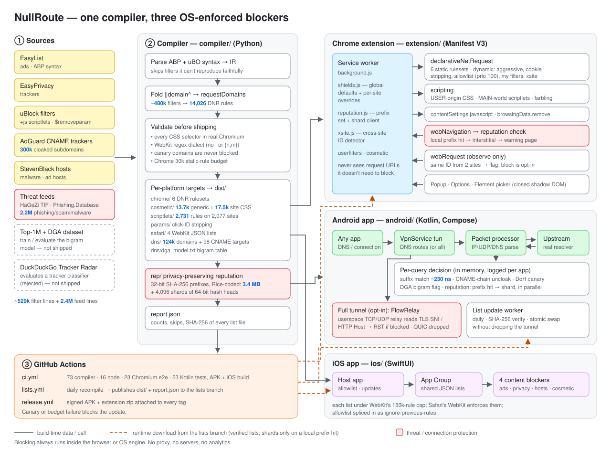
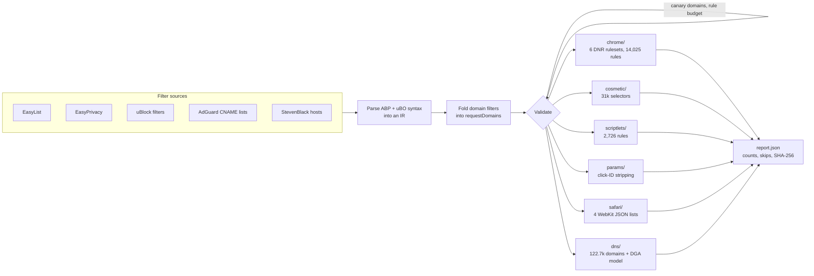
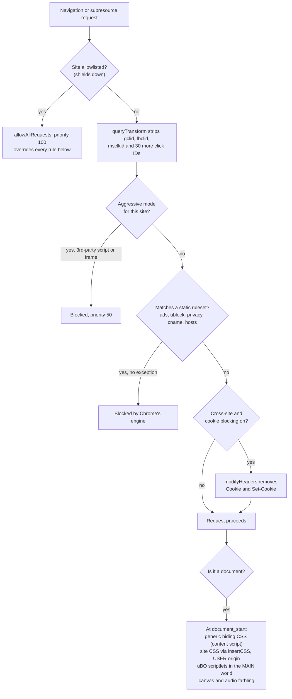
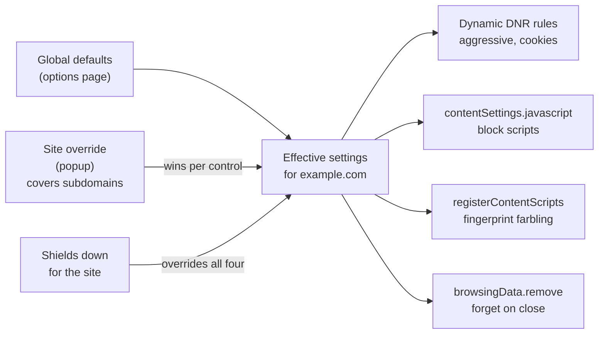
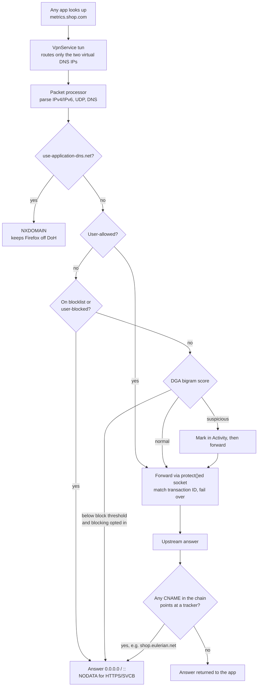
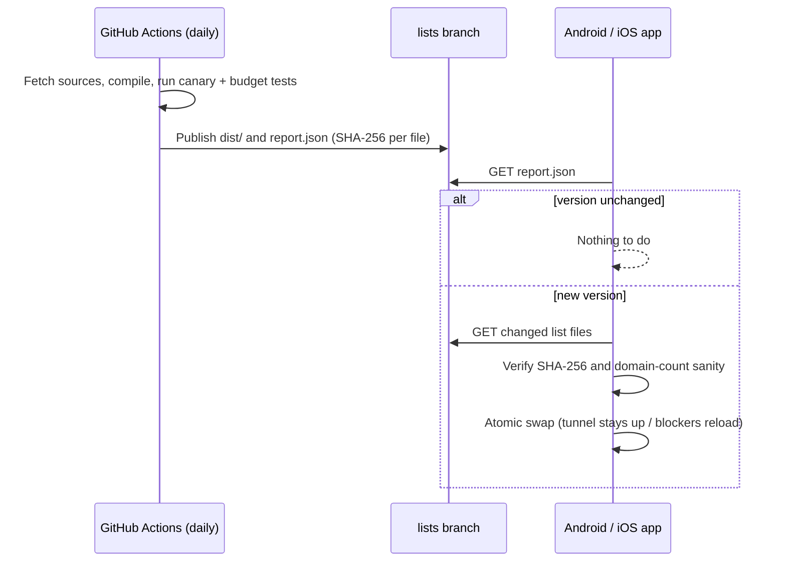

<h1 align="center">NullRoute</h1>

<p align="center">
  <b>A cross-platform ad and tracker blocker: a Chrome extension, an Android app and an iOS Safari blocker, all built from one filter-compilation pipeline.</b>
</p>

<p align="center">
  
  
  
  
  
  
</p>

NullRoute compiles the community-maintained lists that power uBlock Origin and AdGuard (EasyList, EasyPrivacy, uBlock filters, AdGuard's CNAME-cloaking lists and StevenBlack hosts, about 526,000 lines in total). The compiler turns them into the native, OS-enforced rule format each platform expects. **Blocking always runs inside the browser or OS engine.** NullRoute never proxies your traffic, never sees page contents and keeps no browsing history on disk.

| Platform | Mechanism | What it blocks |
|---|---|---|
| **Chrome** (MV3) | `declarativeNetRequest` static and dynamic rules, user-origin CSS, MAIN-world scriptlets, content settings | Network requests, CNAME-cloaked trackers, click-ID link tracking, anti-adblock scripts and on-page ad slots, plus Brave Shields-style per-site controls (scripts, cross-site cookies, fingerprinting, site data) |
| **Android** | Local `VpnService` DNS sinkhole with **CNAME uncloaking** (only DNS enters the tunnel) | Ad and tracker domains in **every app**, including trackers disguised as first-party subdomains, and flags machine-generated domains no list knows yet |
| **iOS / Safari** | Four Safari content-blocker extensions (WebKit rule lists) | Network requests and element hiding in Safari |

<p align="center">
  
  &nbsp;
  
</p>

## Contents

- [Architecture](#architecture)
  - [Compile pipeline](#compile-pipeline)
  - [Chrome: what happens to a request](#chrome-what-happens-to-a-request)
  - [Chrome: per-site settings resolution](#chrome-per-site-settings-resolution)
  - [Android: life of a DNS query](#android-life-of-a-dns-query)
  - [List updates and integrity](#list-updates-and-integrity)
- [Components](#components)
- [Measured on the real lists](#measured-on-the-real-lists)
- [Testing](#testing)
- [Research-informed design](#research-informed-design)
- [Build and run](#build-and-run)
- [Repository layout](#repository-layout)
- [Distribution](#distribution)
- [Privacy](#privacy)
- [Sources and references](#sources-and-references)
- [Licence](#licence)

---

## Architecture

<p align="center">
  
</p>

The system has one build-time half and three run-time halves. The **compiler** is the only place that understands filter syntax. Each platform receives rules already in its engine's native format, so nothing on a device parses a filter list, and every list update is verified against a SHA-256 manifest before use.

### Compile pipeline



Each source list is marked with the platforms that can use it. AdGuard's 300k cloaked-subdomain list, for example, goes only to Chrome: it's over Safari's cap, and Android uncloaks live instead. Filters that can't be reproduced faithfully on a target (regex filters, `$redirect`, `$csp`, procedural cosmetics) are **skipped and counted**, never approximated, so a compiled rule never blocks more than its source filter intended.

### Chrome: what happens to a request



The service worker never sees request URLs. It only writes rules; Chrome's own matcher evaluates them.

### Chrome: per-site settings resolution



Unknown stored values fall back to the global default, and the options page lists every override with a one-click reset.

### Android: life of a DNS query



Every decision is recorded in an in-memory log with the requesting app (`ConnectivityManager.getConnectionOwnerUid`, Android 10+), so the Activity tab can offer a one-tap allow or block.

### List updates and integrity



A failed test in CI stops the publish, so a list update that would block an essential domain (Google, WhatsApp, UPI/NPCI, banks, Play connectivity checks) never reaches a device.

---

## Components

### 1. Filter compiler — `compiler/` (Python, no runtime dependencies)

- **Parses Adblock Plus syntax**: `||domain^`, anchors, wildcards, `$third-party`, `$domain=`, `$denyallow`, `$important`, `$match-case`, `@@` exceptions, `$document`/`$elemhide`/`$generichide`, and `##` / `#@#` cosmetic filters.
- **Parses uBlock Origin extensions**: `##+js(...)` scriptlets with aliases, escaped arguments, per-site exceptions and `#@#+js()` disables, plus `$removeparam` for link-tracking stripping.
- **Folds domain filters.** Every `||domain^` filter sharing the same options merges into one DNR rule with a `requestDomains` list. About 480,000 network filters and domain entries become **14,025 Chrome rules**, so all six rulesets fit inside Chrome's guaranteed 30,000-rule static budget. The 300,034-domain CNAME-cloaking list alone folds into 161 rules.
- **Validates every CSS selector in Chromium** (`CSSStyleSheet.insertRule` via Playwright). One invalid selector in a grouped `a, b, c {}` rule silently disables the whole group, and on Safari it breaks the entire content blocker. The validator catches real cases, such as EasyList selectors with nested `:has()`.
- **Translates ABP patterns to WebKit's regex dialect**, which has no `|` alternation and no `{n,m}`. A validator mirrors WebKit's URL-filter parser.
- **Exports only exact domain filters to DNS**: `||domain^` with no options, plus hosts entries. A filter like `||cdn.site.com^$third-party` is excluded, because a resolver can't know whether a lookup is third-party.
- **Trains and evaluates the DGA model** (`python -m nullroute_compiler.dga`), shipping the bigram table as `dns/dga_model.txt`.
- **Writes `report.json`** with per-list counts, skip reasons and the SHA-256 of every output file.

### 2. Chrome extension — `extension/` (Manifest V3)

- **Network blocking** with Chrome's native `declarativeNetRequest` engine: six static rulesets (ads, uBlock, privacy, CNAME, hosts, link tracking), each toggleable from the options page.
- **Generic element hiding**: a static stylesheet registered as a content script at `document_start`, so ad slots never flash on screen. The 649 sites with exceptions get a filtered copy instead.
- **Site-specific element hiding** injected per navigation with `scripting.insertCSS({origin: 'USER'})`, which pages can't detect or override.
- **Scriptlets in the page's MAIN world** at `document_start`, before any page script runs: `abort-on-property-read`/`-write`, `abort-current-script`, `set-constant`, `json-prune`, `addEventListener-defuser`, `no-setTimeout-if`/`no-setInterval-if` and `no-window-open-if`. These cover 2,726 rules on 2,073 sites. They follow uBlock Origin's semantics; list arguments are only ever used as property paths and patterns, never evaluated as code.
- **Link-tracking removal.** 33 per-user click identifiers (`gclid`, `fbclid`, `msclkid`, `ttclid`, …) are stripped with DNR `queryTransform` before the request leaves the browser. `utm_*` tags are kept on purpose: they identify a campaign, not a person, and removing them breaks landing pages.
- **CNAME-cloaked trackers.** Chrome gives extensions no DNS API, so AdGuard's pre-resolved list of cloaked first-party subdomains is compiled into rules.
- **Per-site controls modelled on Brave Shields.** Every site uses the global defaults unless you change it from the popup. Site changes win, cover subdomains, and are listed with a one-click reset.

  | Control | Implementation |
  |---|---|
  | Trackers & ads: *Aggressive* | One dynamic DNR rule blocking all third-party scripts and frames on the site (uBlock Origin's "medium mode"), priority 50: above list exceptions, below shields down |
  | Block scripts | `chrome.contentSettings.javascript`, which also stops inline scripts and event handlers. DNR alone can only block script files |
  | Block cross-site cookies | DNR `modifyHeaders` strips `Cookie` from third-party requests and `Set-Cookie` from their responses. First-party visits keep their cookies |
  | Block fingerprinting (on by default) | Per-page noise for canvas (`toDataURL`, `toBlob`, `getImageData`) and Web Audio readback, plus a plausible CPU count. Noise is a pure function of a per-page seed and the content, so drawing the same canvas twice gives identical results; per-call random noise is easy to detect. Wrappers are Proxies, so `toString()` still says `[native code]` |
  | Forget site data | `browsingData.remove` for cookies, storage, IndexedDB, caches and service workers, on demand or when the site's last tab closes. Tab-to-site mapping lives in `chrome.storage.session`, so it survives service-worker restarts |
  | Shields down | Priority 100 `allowAllRequests`, which overrides every other control, including script blocking and fingerprint protection |
- **Popup:** per-site switch, live per-category counts (ads, trackers, bad hosts, link tracking, my filters), the advanced controls and "Pause everywhere".
- **Element picker:** hover, click and press Enter to hide anything. Its UI lives in a closed shadow DOM, and auto-generated-looking selectors (hashes, CSS-in-JS) are avoided so rules survive site rebuilds.
- **Options page:** global defaults, site overrides, list toggles that surface Chrome's rule-budget errors, an allowed-sites list, and custom filters in a safe ABP subset.

### 3. Android app — `android/` (Kotlin + Jetpack Compose)

- **Split-tunnel DNS sinkhole.** The VPN routes only two virtual addresses (one IPv4, one IPv6 DNS server) into the tunnel. All other traffic uses the normal network at full speed, so battery cost is negligible.
- **CNAME uncloaking.** Every allowed answer is inspected; if any alias in the chain points at a tracker, the app gets a sinkhole answer instead. `metrics.shop.com` → `shop.eulerian.net` is blocked even though `metrics.shop.com` is on no list. AdGuard's CNAME-tracker list is used only for CNAME targets, never as direct blocks, because it includes vendors' own websites. The compression-aware parser has a hop limit, so a malicious pointer loop can't hang the resolver.
- **Unlisted machine-generated domains.** A character-bigram model marks suspicious lookups in Activity. Blocking them is opt-in (see [Zero-day domains](#zero-day-domains-what-the-real-time-blocking-proposal-holds-up-to)).
- **Firefox DoH canary.** `use-application-dns.net` gets NXDOMAIN, which tells Firefox to keep using system DNS so its lookups stay filtered.
- **Sinkhole answers.** Blocked names get `0.0.0.0` / `::` immediately; HTTPS and SVCB records get NODATA. Allowed queries go to the real resolver over sockets excluded from the tunnel with `VpnService.protect()`. Replies are matched by transaction ID, so spoofed answers are dropped. If one resolver fails the next is tried, and SERVFAIL is returned only when all fail.
- **Pure-Kotlin engine** (`android/core`): IPv4/IPv6/UDP parsing, RFC 1071 checksums, DNS encoding, suffix matching, the DGA detector and the forwarder, with **no Android dependencies**, so it's unit-tested on the JVM.
- **Per-app attribution**, excluded apps (for banking apps that break), a choice of resolver (network default, Cloudflare, Quad9, Google), a Quick Settings tile, Always-on VPN support and restore after reboot.
- **Verified list updates** with SHA-256 checks against `report.json` and an atomic swap that keeps the tunnel up.
- **Private DNS detection.** Warns when Android's Private DNS is in strict mode, which would silently bypass any DNS filter.

### 4. iOS app — `ios/` (SwiftUI)

- **Four Safari content blockers**, each under WebKit's 150,000-rule cap: Ads 89,981 · Trackers 103,531 · Bad hosts 41,320 · Element hiding 7,820.
- **Host app** shows which blockers are enabled, manages allowed sites and installs verified list updates through a shared App Group. Allowed sites are applied by appending one `ignore-previous-rules` rule to each list through byte-splicing, so the 20 MB lists are never parsed on the device.

---

## Measured on the real lists

| | |
|---|---|
| Source lines parsed | ~526,000 |
| Chrome DNR rules (6 rulesets) | **14,025** (budget: 30,000 guaranteed) |
| CNAME-cloaked subdomains | 300,034 folded into **161** rules |
| Scriptlets | 2,726 rules on 2,073 sites |
| Cosmetic selectors | 13,676 generic + 17,510 site-specific |
| DNS blocklist | 122,729 domains after subdomain minimisation, plus 98 CNAME targets |
| Safari rule lists | 89,981 · 103,531 · 41,320 · 7,820 (cap: 150,000 each) |
| Android matcher | ~13 MB heap, **~230 ns per lookup** (JVM benchmark) |
| DGA detector | 35.3% of DGA domains blocked at 0.14% false positives |
| Full compile | ~18 s |

## Testing

| Suite | Tests | What it proves |
|---|---|---|
| `compiler/tests` | 67 | ABP parsing edge cases, rule folding, Safari regex semantics checked against real URLs, WebKit dialect validation, canary domains, Chrome budget, `report.json` hashes, DGA model training and scoring |
| `extension/tests/shields.test.mjs` | 8 (Node) | The per-site settings model: override resolution and inheritance, invalid stored values, DNR rule generation for aggressive mode and cookies, content-settings precedence, fingerprint-script registration, shred origins |
| `extension/tests/test_e2e.py` | 21 (Chromium) | Loads the real extension, maps every hostname to local HTTP and HTTPS servers with `--host-resolver-rules`, and checks **which requests actually left the browser**: every list, CNAME-cloaked subdomains, click-ID stripping, uBlock scriptlets running before page scripts, generic and site-specific hiding, allowlisting, custom filters, pause, per-list toggles, the element picker and Chrome's own `isRegexSupported` on every regex rule. Per-site controls are tested end to end, including real `SameSite=None; Secure` cookies over HTTPS, canvas noise that is stable within a page but differs across loads, and site data cleared on demand and on last-tab close |
| `android/core` | 33 (JUnit) | Packets generated by **scapy** and **dnslib** (independent implementations) parse correctly; the IPv6 encoder reproduces scapy's bytes exactly; CNAME chains with name compression are uncloaked while benign CDN aliases pass; pointer loops terminate; the DoH canary answers NXDOMAIN; **real UDP forwarding** against a local resolver works, including spoofed-ID rejection and failover; the Kotlin DGA detector reproduces the Python reference scores to 10⁻³ |

CI (`.github/workflows/ci.yml`) runs all of these, and also builds the Android APK with lint and the iOS app for the simulator.

---

## Research-informed design

Design decisions trace back to the measurement and systems literature on ad blocking. Numbers in brackets refer to [Sources and references](#sources-and-references).

### Applied

| Finding | What NullRoute does |
|---|---|
| CNAME cloaking hides trackers behind first-party subdomains, on about 10% of the top 10k sites [R1]. Chrome extensions can't resolve DNS to unmask them. | Android uncloaks every answer's CNAME chain. Chrome ships AdGuard's 300k pre-resolved cloaked subdomains as folded DNR rules [D3]. |
| Click IDs in links smuggle user identifiers past cookie partitioning [R2, R3]. | DNR `queryTransform` strips 33 click-ID parameters, plus `$removeparam` filters from the lists, before navigation. |
| Anti-adblock and ad logic moved into first-party bundles and inline JSON, where URL blocking breaks the site [R4, R5]. | MAIN-world scriptlets compiled from uBlock filters neutralise the specific property or call instead of the whole script. |
| Most list rules are dead weight and list growth has a real cost [R6]. | Rules are folded and budget-checked at build time; the device never parses a list. |
| Naive substring matching causes collateral breakage. | All domain matching is label-boundary suffix matching on every platform, and canary tests guard essential domains. |
| Encrypted DNS silently bypasses DNS filters [P11]. | The Firefox canary keeps Firefox on system DNS, and the app warns when Android Private DNS is in strict mode. |
| MV3 rule budgets are the central constraint (30k guaranteed static, 1,000 regex, 2 KB per regex) [P1]. | Domain folding, a build-time budget check, and an e2e test that runs Chrome's `isRegexSupported` on every regex rule. |
| Breakage makes users turn blockers off entirely [R7]. | One-tap per-site allowlist (which also disables scriptlets and hiding), per-list toggles, and a per-lookup "Always allow" on Android. |
| Per-call random canvas noise is itself a fingerprint [R8]. | Farbling is deterministic per page seed and content, modelled on Brave's approach [P10]. |

One claim was checked rather than copied. A survey cited a 50,000-rule cap per Safari content blocker; that figure predates Safari 15. The current limit is 150,000 [P9], which the iOS blockers are sized for.

### Brave Shields' controls, mapped to what an extension can do

| Brave Shields control | NullRoute |
|---|---|
| Trackers & ads (Standard / Aggressive / Allow all) | Lists; per-site aggressive rule; per-site shields down |
| Block scripts | `contentSettings.javascript`, per site or global [P3] |
| Block cookies | DNR `modifyHeaders` cross-site `Cookie` / `Set-Cookie` stripping |
| Block fingerprinting | MAIN-world canvas and audio farbling, consistent within a page |
| Shred site's data (+ on close) | `browsingData.remove` by origin, manually or when the last tab closes [P4] |
| Block element | Element picker |
| Global settings | Options page "Defaults for every site", with a list of site overrides |
| Upgrade connections to HTTPS | **Left to Chrome.** Chrome upgrades navigations natively *with* HTTP fallback [P5]; a DNR `upgradeScheme` rule has no fallback and would break HTTP-only sites. |

On mobile, the Android app's per-app exclusions play the role of per-site overrides (DNS has no notion of the page you're on). Safari already blocks cross-site cookies by default, and its content blockers can't run scripts, so the remaining controls don't apply there.

### Zero-day domains: what the "real-time blocking" proposal holds up to

A proposal suggested sinkholing any unlisted domain whose Shannon entropy exceeds 4.15. It was measured on a labelled dataset before anything was built: 25 DGA malware families plus benign domains, 675k names, used only for evaluation [D6].

| Detector | DGA domains caught | Legitimate domains wrongly flagged |
|---|---|---|
| Entropy > 4.15 (as proposed) | 3.7% | 0.13% |
| Entropy > 3.5 | 51.8% | 30.0% |
| **NullRoute bigram model, block threshold** | **35.3%** | **0.14%** |
| **NullRoute bigram model, flag threshold** | **53.6%** | **0.53%** |

Entropy fails because an *n*-character string can never exceed log₂(*n*) bits: a 13-character DGA label tops out at 3.70, so the 4.15 threshold almost never fires, and lowering it flags real sites by the thousand. NullRoute instead scores how much the **registrant's label** looks like real domain names, using a character-bigram model trained on a public top-1M list [D5] and calibrated on held-out names. `d1a2b3.cloudfront.net` and `r4---sn-x.googlevideo.com` are judged as `cloudfront` / `googlevideo`, and dynamic-DNS subdomains are judged by the customer's label. At the same false-positive rate it catches about 10× more than entropy, and 77–100% of random-character families (rovnix, corebot, qadars, murofet, emotet, cryptolocker, necurs and others). Dictionary-word DGAs (suppobox, matsnu, gozi) look like English and stay out of reach of any character model; that's reported rather than hidden.

On Android, suspicious names are **marked in Activity by default and never blocked** unless you opt in. `python -m nullroute_compiler.dga evaluate` reproduces the table.

The proposal's other real-time ideas were assessed and not built:

- **Cloud reputation lookups** would send every new hostname to a server, breaking the property that browsing data never leaves the device. A privacy-preserving version would use hashed-prefix lookups as Safe Browsing's Update API does [P12]. That's future work.
- **TLS SNI inspection** would mean routing *all* traffic through a userspace TCP/IP stack instead of just DNS, costing battery and latency. It adds little: the SNI hostname was already resolved through the DNS NullRoute sees, and Encrypted Client Hello increasingly hides it.

### Deliberately not applied

- **YouTube video ads.** YouTube's SABR streaming protocol enforces a server-side backoff when ad placements are stripped client-side, so json-prune-style blocking now produces "fake buffering". NullRoute makes no YouTube video-ad claim.
- **ML, graph and perceptual classifiers** [R9–R11]. These need browser forks, add latency, or are vulnerable to adversarial perturbations [R12, R13]. Static compiled lists stay fast and auditable. An ONNX classifier in the AdFlush style [R11] is the most deployable next step.
- **Differential list updates.** CI rebuilds daily and the apps download only when the version changes. Diff patches would cut bandwidth but aren't needed at this size.

---

## Build and run

Requirements (as tested in CI): Python 3.12, Node 22, and for tests `pip install pytest playwright` plus `openssl`. Android needs JDK 17 and the Android SDK; iOS needs Xcode and [XcodeGen](https://github.com/yonaskolb/XcodeGen).

```bash
make lists        # fetch + compile every list into dist/
make test         # compiler tests + Chrome unit and e2e tests
```

**Chrome:** run `make extension`, open `chrome://extensions`, enable Developer mode, click **Load unpacked** and choose `extension/`.

**Android:** run `make lists`, then open `android/` in Android Studio or run `./gradlew :app:assembleDebug`. Install the APK, tap **Turn on** and accept the VPN prompt. For protection that survives reboots, enable Always-on VPN for NullRoute in Settings › Network & internet › VPN.

**iOS:** run `make lists && brew install xcodegen && make ios`, open `ios/NullRoute.xcodeproj`, set your team and run. Then enable the four NullRoute blockers in Settings › Apps › Safari › Extensions.

## Repository layout

```text
nullroute/
├── compiler/                  Python filter compiler (no runtime deps)
│   ├── nullroute_compiler/
│   │   ├── abp.py             ABP + uBO parser → IR
│   │   ├── domains.py         domain normalisation and folding
│   │   ├── validate.py        Chromium CSS + WebKit regex validators
│   │   ├── dga.py             bigram model: train / evaluate / export
│   │   └── targets/           chrome · cosmetic · scriptlets · params · safari · dns
│   ├── sources.json           list URLs and per-platform targets
│   └── tests/
├── extension/                 Chrome MV3 extension
│   ├── src/background.js      service worker
│   ├── src/lib/               shields · userfilters · cosmetic · domains
│   ├── src/scriptlets/        uBO-compatible scriptlet library
│   ├── src/shields/farble.js  canvas / audio farbling
│   └── tests/                 Node unit + Chromium e2e
├── android/
│   ├── core/                  pure-Kotlin packet, DNS, matcher, DGA, forwarder
│   └── app/                   VpnService, Compose UI, list updates
├── ios/                       XcodeGen project, SwiftUI app, 4 content blockers
├── .github/workflows/         ci · lists (daily) · release
└── docs/                      architecture.svg, screenshots
```

## Distribution

- **Chrome Web Store:** MV3 with `declarativeNetRequest` is the store-approved model for blockers.
- **Android:** Google Play prohibits apps that block ads in other apps, including through `VpnService` filtering [P8]. The APK ships through GitHub Releases (`release.yml` attaches a signed build to every tag) or F-Droid, as Blokada and DNS66 do.
- **iOS App Store:** Safari content blockers are an Apple-supported extension type [P9].

## Privacy

- The Chrome extension never reads request URLs. Chrome's engine evaluates the rules.
- On Android, the query log lives only in memory, is cleared each session and is never written to disk. Only blocked-request counts are stored.
- On iOS, Safari compiles and enforces the rules. The extensions never see browsing data.
- No analytics, no accounts, no servers. The only network calls NullRoute makes are list downloads from this repository.

---

## Sources and references

### Research

| # | Reference | Used for |
|---|---|---|
| R1 | Dimova, Acar, Olejnik, Joosen, Van Goethem. [*The CNAME of the Game: Large-scale Analysis of DNS-based Tracking Evasion*](https://petsymposium.org/popets/2021/popets-2021-0053.php). PoPETs 2021. ([arXiv](https://arxiv.org/abs/2102.09301)) | CNAME uncloaking on Android, cloaked-subdomain rules on Chrome |
| R2 | Randall et al. [*Measuring UID Smuggling in the Wild*](https://www.sysnet.ucsd.edu/~voelker/pubs/uid-smuggle-imc22.pdf). IMC 2022. | Click-ID stripping |
| R3 | Munir et al. [*PURL: Safe and Effective Sanitization of Link Decoration*](https://www.usenix.org/system/files/usenixsecurity24-munir.pdf). USENIX Security 2024. ([arXiv](https://arxiv.org/abs/2308.03417)) | Which parameters to strip, and why `utm_*` is kept |
| R4 | Smith, Snyder, Livshits, Stefan et al. [*SugarCoat: Programmatically Generating Privacy-Preserving, Web-Compatible Resource Replacements*](https://www.doc.ic.ac.uk/~livshits/papers/pdf/ccs21.pdf). CCS 2021. | Neutralising scripts instead of blocking them |
| R5 | Iqbal, Shafiq, Qian. [*The Ad Wars: Retrospective Measurement and Analysis of Anti-Adblock Filter Lists*](https://par.nsf.gov/biblio/10073730). IMC 2017. | Anti-adblock scriptlets |
| R6 | Snyder, Vastel, Livshits. [*Who Filters the Filters: Understanding the Growth, Usefulness and Efficiency of Crowdsourced Ad Blocking*](https://arxiv.org/abs/1810.09160). SIGMETRICS 2020. | Rule folding, build-time budgets |
| R7 | Nisenoff et al. [*User Experiences and Remediation Tactics When Ad-Blocking or Tracking-Protection Tools Break Websites*](https://www.usenix.org/conference/usenixsecurity23/presentation/nisenoff-broken). USENIX Security 2023. | One-tap allowlisting, per-list toggles |
| R8 | [Canvas fingerprinting randomization study](https://cseweb.ucsd.edu/~savage/papers/IMC25Canvas.pdf). IMC 2025. | Deterministic, per-page farbling |
| R9 | Iqbal et al. [*AdGraph: A Graph-Based Approach to Ad and Tracker Blocking*](https://arxiv.org/abs/1805.09155). IEEE S&P 2020. | Considered, not applied |
| R10 | Siby et al. [*WebGraph: Capturing Advertising and Tracking Information Flows for Robust Blocking*](https://www.usenix.org/conference/usenixsecurity22/presentation/siby). USENIX Security 2022. | Considered, not applied |
| R11 | [*AdFlush: A Real-World Deployable Machine Learning Solution for Effective Advertisement and Web Tracker Prediction*](https://doi.org/10.1145/3589334.3645698). WWW 2024. ([code](https://github.com/0xk1h0/AdFlush)) | Most deployable future ML option |
| R12 | Tramèr, Dupré, Rusak, Pellegrino, Boneh. [*AdVersarial: Perceptual Ad Blocking meets Adversarial Machine Learning*](https://arxiv.org/abs/1811.03194). CCS 2019. | Why perceptual blocking was not built |
| R13 | Zhu et al. [*A4: Evading Learning-based Adblockers*](https://arxiv.org/abs/2001.10999). | Adversarial evasion of ML blockers |
| R14 | Cucchiarelli, Morbidoni, Spalazzi, Baldi. [*Algorithmically generated malicious domain names detection based on n-grams features*](https://doi.org/10.1016/j.eswa.2020.114551). Expert Systems with Applications, 2021. | DGA evaluation dataset and n-gram approach |

### Platform documentation

| # | Reference |
|---|---|
| P1 | Chrome: [`chrome.declarativeNetRequest`](https://developer.chrome.com/docs/extensions/reference/api/declarativeNetRequest) (rule limits, `requestDomains`, `queryTransform`, `modifyHeaders`, `allowAllRequests`) |
| P2 | Chrome: [`chrome.scripting`](https://developer.chrome.com/docs/extensions/reference/api/scripting) (`registerContentScripts`, MAIN world, `insertCSS` USER origin) |
| P3 | Chrome: [`chrome.contentSettings`](https://developer.chrome.com/docs/extensions/reference/api/contentSettings) |
| P4 | Chrome: [`chrome.browsingData`](https://developer.chrome.com/docs/extensions/reference/api/browsingData) and [`chrome.storage`](https://developer.chrome.com/docs/extensions/reference/api/storage) |
| P5 | Chromium Blog: [*Towards HTTPS by default*](https://blog.chromium.org/2023/08/towards-https-by-default.html) (2023) |
| P6 | Android: [`VpnService`](https://developer.android.com/reference/android/net/VpnService) and [`ConnectivityManager.getConnectionOwnerUid`](https://developer.android.com/reference/android/net/ConnectivityManager#getConnectionOwnerUid(int,%20java.net.InetSocketAddress,%20java.net.InetSocketAddress)) |
| P7 | Android 14: [Foreground service types are required](https://developer.android.com/about/versions/14/changes/fgs-types-required) |
| P8 | The Register: [*Google Play changes VPN rules*](https://www.theregister.com/2022/08/30/google_play_vpn_rules_changed/) (2022) |
| P9 | Apple: [*Creating a content blocker*](https://developer.apple.com/documentation/safariservices/creating-a-content-blocker); AdGuard KB: [Safari rule limit](https://adguard.com/kb/adguard-for-safari/solving-problems/rule-limit/) (150k per blocker) |
| P10 | Brave: [*Fingerprinting defenses 2.0*](https://brave.com/privacy-updates/4-fingerprinting-defenses-2.0/) (farbling) |
| P11 | Mozilla: [*Canary domain – use-application-dns.net*](https://support.mozilla.org/kb/canary-domain-use-application-dnsnet) |
| P12 | Google: [Safe Browsing Update API](https://developers.google.com/safe-browsing/v4/update-api) |
| P13 | uBlock Origin wiki: [Static filter syntax](https://github.com/gorhill/uBlock/wiki/Static-filter-syntax) and [Resources library (scriptlets)](https://github.com/gorhill/uBlock/wiki/Resources-Library); Adblock Plus: [How to write filters](https://help.adblockplus.org/hc/en-us/articles/360062733293) |

### Protocol specifications

- [RFC 768](https://www.rfc-editor.org/rfc/rfc768) – User Datagram Protocol
- [RFC 791](https://www.rfc-editor.org/rfc/rfc791) – Internet Protocol (IPv4)
- [RFC 8200](https://www.rfc-editor.org/rfc/rfc8200) – Internet Protocol, Version 6
- [RFC 1035](https://www.rfc-editor.org/rfc/rfc1035) – Domain Names: Implementation and Specification (including name compression)
- [RFC 1071](https://www.rfc-editor.org/rfc/rfc1071) – Computing the Internet Checksum
- [RFC 9460](https://www.rfc-editor.org/rfc/rfc9460) – SVCB and HTTPS resource records

### Filter lists and datasets

| # | Source | Licence |
|---|---|---|
| D1 | [EasyList and EasyPrivacy](https://easylist.to/) ([GitHub](https://github.com/easylist/easylist)) | GPLv3 / CC BY-SA 3.0 |
| D2 | [uBlock Origin filters (uAssets)](https://github.com/uBlockOrigin/uAssets) | GPLv3 |
| D3 | [AdGuard CNAME trackers](https://github.com/AdguardTeam/cname-trackers) | MIT |
| D4 | [StevenBlack hosts](https://github.com/StevenBlack/hosts) | MIT |
| D5 | [Top 1,000,000 domains](https://github.com/zer0h/top-1000000-domains) (bigram training) | — |
| D6 | [DGA domains dataset](https://github.com/chrmor/DGA_domains_dataset) from R14 (evaluation only, not shipped) | — |

### Tools

[Playwright](https://playwright.dev/) (selector validation, e2e tests) · [scapy](https://scapy.net/) and [dnslib](https://github.com/paulc/dnslib) (independent packet fixtures) · [XcodeGen](https://github.com/yonaskolb/XcodeGen) · [Jetpack Compose](https://developer.android.com/develop/ui/compose)

## Licence

GPL-3.0. Filter lists keep their own licences (table above): EasyList and EasyPrivacy © The EasyList authors, uBlock filters © Raymond Hill and contributors, AdGuard CNAME trackers © AdGuard, StevenBlack hosts © Steven Black. Scriptlet behaviour follows uBlock Origin's documented semantics; the implementation is original.
