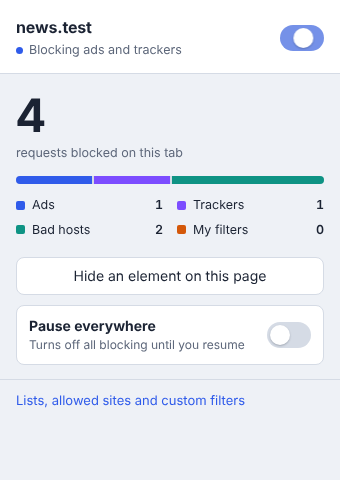
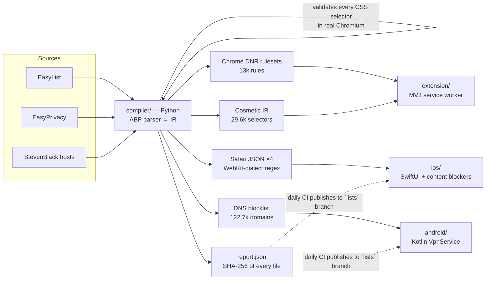

# NullRoute

**A cross-platform ad and tracker blocker: a Chrome extension, an Android app, and an iOS Safari blocker, all built from one filter-compilation pipeline.**

NullRoute compiles the community-maintained lists that power uBlock Origin and AdGuard: EasyList, EasyPrivacy and StevenBlack hosts, about 215,000 lines in total. The compiler turns them into the native, OS-enforced rule format each platform expects:

| Platform | Mechanism | What it blocks |
|---|---|---|
| **Chrome** (MV3) | `declarativeNetRequest` static rulesets plus user-origin CSS | Network requests and on-page ad slots, with an element picker |
| **Android** | Local `VpnService` DNS sinkhole (only DNS enters the tunnel) | Ad and tracker domains in **every app**, with per-app attribution |
| **iOS / Safari** | Four Safari content-blocker extensions (WebKit rule lists) | Network requests and element hiding in Safari |

Blocking is always done by the browser or OS engine itself. NullRoute never proxies your traffic, never sees page contents, and keeps no browsing history on disk.

<p align="center"> </p>

---

## Architecture



### 1. Filter compiler (`compiler/`, Python, no runtime dependencies)

- **Parses Adblock Plus syntax**: `||domain^`, anchors, wildcards, `$third-party`, `$domain=`, `$denyallow`, `$important`, `$match-case`, `@@` exceptions, `$document`/`$elemhide`/`$generichide`, and `##` / `#@#` cosmetic filters.
- **Skips filters it can't reproduce faithfully** rather than approximating them. That covers regex filters, scriptlets, `$redirect`, `$csp` and procedural cosmetics. Each skip is counted in `report.json`, so a compiled rule never blocks more than its source filter intended.
- **Folds domain filters.** Every `||domain^` filter sharing the same options is merged into a single DNR rule with a `requestDomains` list. On the real lists this turns **179,000 network filters and hosts entries into 13,061 Chrome rules**, so all three lists fit inside Chrome's guaranteed 30,000-rule static budget.
- **Validates every CSS selector in Chromium** (`CSSStyleSheet.insertRule` via Playwright). One invalid selector in a grouped `a, b, c {}` rule silently disables the whole group, and on Safari it breaks the entire content blocker. The validator catches real cases, such as EasyList selectors with nested `:has()`.
- **Translates ABP patterns to WebKit's regex dialect**, which has no `|` alternation and no `{n,m}`. A validator mirrors WebKit's URL-filter parser rules.
- **Exports only exact domain filters to DNS.** It includes `||domain^` with no options plus hosts entries. A filter like `||cdn.site.com^$third-party` is excluded, because a resolver can't know whether a lookup is third-party, and sinkholing it would break the first-party site.
- **Has a canary test.** A list of essential domains (Google, WhatsApp, UPI/NPCI, banks, Play Store connectivity checks, and so on) must never be blocked. CI fails if a list update would break them.

### 2. Chrome extension (`extension/`, Manifest V3)

- **Network blocking** uses Chrome's native `declarativeNetRequest` engine with three toggleable static rulesets (Ads, Trackers, Bad hosts).
- **Generic element hiding** is a static stylesheet registered as a content script at `document_start`, so ad slots never flash on screen. The 649 sites that have exceptions are excluded from it and get a filtered copy instead.
- **Site-specific element hiding** is injected per navigation with `scripting.insertCSS({origin: 'USER'})`, which pages can't detect or override.
- **Popup:** a per-site on/off switch, a live per-list breakdown of blocked requests, and a "Pause everywhere" toggle.
- **Element picker:** hover, click and press Enter to hide anything. Its UI lives in a closed shadow DOM, and selectors that look auto-generated (hashes, CSS-in-JS) are skipped so rules survive site rebuilds.
- **Options page:** list toggles that surface Chrome's rule-budget errors, an allowed-sites list, and custom filters in a safe ABP subset.

### 3. Android app (`android/`, Kotlin + Jetpack Compose)

- **Split-tunnel DNS sinkhole.** The VPN routes only two virtual host addresses (one IPv4, one IPv6 DNS server) into the tunnel. All other traffic keeps using the normal network at full speed, and battery cost is negligible.
- **Sinkhole answers.** Blocked names get `0.0.0.0` / `::` immediately; HTTPS and SVCB records get NODATA. Allowed queries are relayed to the real resolver over sockets excluded from the tunnel with `VpnService.protect()`. Replies are matched by transaction ID, so spoofed answers are dropped. If one resolver fails the next is tried, and SERVFAIL is returned only when all fail.
- **Pure-Kotlin engine** (`android/core`): IPv4/IPv6/UDP parsing, RFC 1071 checksums, DNS encoding, suffix matching and the forwarder. It has **no Android dependencies**, so it is unit-tested on the JVM.
- **Per-app attribution** uses `ConnectivityManager.getConnectionOwnerUid` on Android 10+. The Activity tab shows which app looked up which domain, and one tap allows or blocks it.
- **Excluded apps** (for banking apps and others that break), a choice of DNS resolver (network default, Cloudflare, Quad9, Google), a Quick Settings tile, always-on VPN support, and restore after reboot.
- **Signed list updates.** It downloads from the `lists` branch, verifies SHA-256 against `report.json`, sanity-checks the domain count, and swaps lists atomically without dropping the tunnel.
- **Private DNS detection.** It warns you when Android's Private DNS is in strict mode, which would silently bypass any DNS filter.

### 4. iOS app (`ios/`, SwiftUI)

- **Four Safari content blockers**, each under WebKit's 150,000-rule cap: Ads 90k, Trackers 104k, Bad hosts 41k, Element hiding 7.8k.
- **Host app:** shows which blockers are enabled in Settings, manages allowed sites, and installs verified list updates. Allowed sites are applied by appending one `ignore-previous-rules` rule to each list through byte-splicing, so the 20 MB lists are never parsed on the device.

---

## Measured on the real lists

| | |
|---|---|
| Source lines parsed | 215,530 |
| Chrome DNR rules (all 3 lists) | **13,061** (budget: 30,000 guaranteed) |
| Cosmetic selectors | 13,635 generic + 15,966 site-specific across 7,490 sites |
| DNS blocklist | 122,697 domains after subdomain minimisation |
| Android matcher | ~13 MB heap, **~230 ns per lookup** (JVM benchmark) |
| Full compile | ~9 s |

## Testing

| Suite | What it proves |
|---|---|
| `compiler/tests` (42 tests) | ABP parsing edge cases, rule folding, Safari regex semantics checked against real URLs, WebKit dialect validation, canary domains, Chrome budget, `report.json` hashes |
| `extension/tests` (11 Chromium end-to-end tests) | Loads the real extension, maps every hostname to a local server with `--host-resolver-rules`, and checks **which requests actually left the browser**. Covers all three lists, generic and site-specific hiding, allowlisting, custom filters, pause, per-list toggles, the element picker, and the UI pages |
| `android/core` (21 tests) | Packets generated by **scapy** (an independent implementation) parse correctly, our IPv6 encoder reproduces scapy's bytes exactly, sinkhole replies decode in dnslib, and **real UDP forwarding** against a local resolver works, including spoofed-ID rejection and failover |

CI (`.github/workflows/ci.yml`) runs all of these. It also builds the Android APK with lint and the iOS app for the simulator.

## Build and run

```bash
make lists        # fetch + compile lists into dist/
make test         # compiler tests + Chrome e2e tests (needs: pip install pytest playwright)
```

**Chrome:** run `make extension`, open `chrome://extensions`, enable Developer mode, click **Load unpacked**, and choose `extension/`.

**Android:** run `make lists`, then open `android/` in Android Studio (or run `./gradlew :app:assembleDebug`). Install the APK, tap **Turn on**, and accept the VPN prompt. For protection that survives reboots, enable Always-on VPN for NullRoute in Settings › Network & internet › VPN.

**iOS:** run `make lists && brew install xcodegen && make ios`, open `ios/NullRoute.xcodeproj`, set your team, and run. Then enable the four NullRoute blockers in Settings › Apps › Safari › Extensions.

## Distribution notes

- **Chrome Web Store:** MV3 with `declarativeNetRequest` is the store-approved model for blockers.
- **Android:** Google Play prohibits apps that block ads in other apps, including through `VpnService` filtering. The APK is distributed through GitHub Releases (`release.yml` attaches a signed build on every tag) or F-Droid, as Blokada and DNS66 do.
- **iOS App Store:** Safari content blockers are an Apple-supported extension type.

## Privacy

- The Chrome extension never reads request URLs. Chrome's engine evaluates the rules.
- On Android, the query log lives only in memory, is cleared each session, and is never written to disk. Only blocked-request counts are stored.
- On iOS, Safari compiles and enforces the rules. The extensions never see browsing data.
- No analytics, no accounts, no servers. The only network calls NullRoute makes are list downloads from this repository.

## Licence

GPL-3.0. Filter lists: EasyList and EasyPrivacy (GPLv3 / CC BY-SA 3.0, © The EasyList authors), StevenBlack hosts (MIT).
